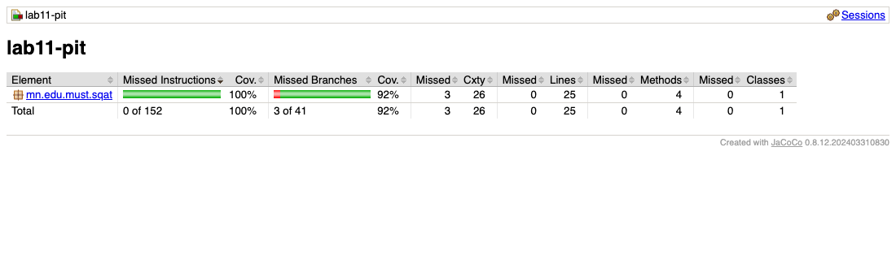

# Лаб 11 — Mutation testing (PIT)

Бай: `ScholarshipCalculator` (Лаб 9-ийн засагдсан хувилбар). `src/main`-ийг энэ лабын турш өөрчлөхгүй, зөвхөн тест засна.

## Хэрэгслүүд ба лиценз

| Хэрэгсэл | Лиценз | Тайлбар |
|---|---|---|
| OpenJDK 17+, Maven | GPLv2+CE / Apache 2.0 | Өмнөх лабуудын орчин хэвээр |
| JUnit 5 (Jupiter) | EPL 2.0 — нээлттэй эх | Тестийн фрэймворк |
| JaCoCo | EPL 2.0 — нээлттэй эх | Хамралтын хэрэгсэл |
| PIT (pitest) | Apache 2.0 — нээлттэй эх | Mutation testing хэрэгсэл |
| git + GitHub | GPL / үнэгүй үйлчилгээ | Тайлангаа байршуулах |

Ашигласан орчин: OpenJDK 17.0.17, Apache Maven 3.9.16, PIT 1.16.1 (STRONGER mutators), JaCoCo 0.8.12, macOS.

## Алхам 1: Starter төсөл ба хоёр хэмжилт

`starter.zip`-ийг задалж, юу ч өөрчлөхөөс өмнө `git init` хийгээд эхний commit-ыг (`Starter`) хийсэн.

```bash
mkdir -p results
mvn clean verify 2>&1 | tee results/mvn-verify-start.txt
cp target/site/jacoco/jacoco.csv results/jacoco-start.csv

mvn test-compile org.pitest:pitest-maven:mutationCoverage 2>&1 | tee results/pit-start.txt
```

### JaCoCo — хамралт



`results/jacoco-start.csv`-ээс:

| Хэмжүүр | Хамрагдсан | Нийт | % |
|---|---|---|---|
| Line | 25 | 25 | **100%** |
| Branch | 38 | 41 | 92% (3 missed) |
| Instruction | 152 | 152 | 100% |
| Method | 4 | 4 | 100% |

→ **Line 100% (25/25), Branch 38/41** гэдэг нь батлагдлаа. 6 тест бүгд амжилттай (`Tests run: 6, Failures: 0`).

### PIT — mutation coverage


`results/pit-start.txt`-ийн төгсгөлөөс:

```
>> Line Coverage (for mutated classes only): 25/25 (100%)
>> Generated 63 mutations Killed 17 (27%)
>> Mutations with no coverage 0. Test strength 27%
```

| Хэмжүүр | Утга |
|---|---|
| Line coverage | 25/25 (100%) |
| Үүссэн мутант | 63 |
| Устгасан (Killed) | **17** |
| Амьд үлдсэн (Survived) | 46 |
| Mutation score | **27%** |

### Эхний ажиглалт

Line coverage 100% боловч mutation score ердөө 27% (63-аас 17 мутант устсан) байна. Энэ нь тестүүд кодын мөр бүрийг *ажиллуулж* байгаа ч үр дүнг нь бараг *шалгахгүй* байгааг харуулж байна: `assertNotNull`, `0 ≤ x ≤ 100` гэх мэт сул assertion нь "B"-г "A" болгосон, `>=`-ийг `>` болгосон, буцаах утгыг 0 болгосон зэрэг өөрчлөлтийг ялгаж чаддаггүй тул 46 мутант амьд үлдсэн. Өөрөөр хэлбэл хамралт нь "аль код ажилласан"-ыг, mutation score нь "тест алдааг барьж чадах эсэх"-ийг хэмждэг тул хамралт өндөр байх нь тестийн чанар сайн гэсэн үг биш.
