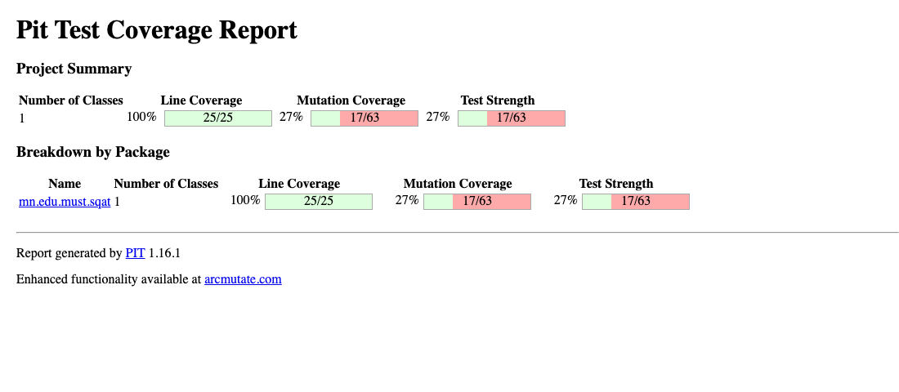
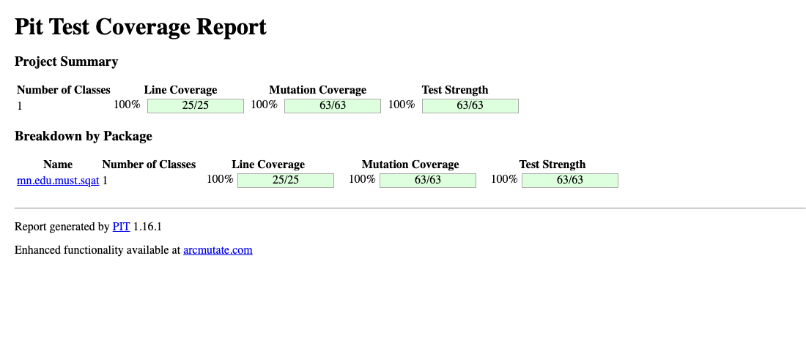
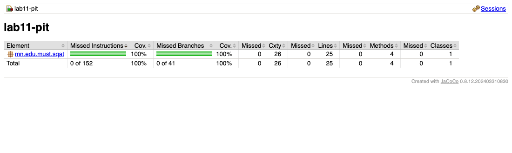

# Лаб 11 — Mutation testing (PIT)

Бай: `ScholarshipCalculator` (Лаб 9-ийн засагдсан хувилбар). `src/main`-ийг энэ лабын турш өөрчлөхгүй, зөвхөн тест засна.

## Хэрэгслүүд ба лиценз

| Хэрэгсэл | Лиценз | Тайлбар |
|---|---|---|
| OpenJDK 17+, Maven | GPLv2+CE / Apache 2.0 | Өмнөх лабуудын орчин хэвээр |
| JUnit 5 (Jupiter) | EPL 2.0 — нээлттэй эх | Тестийн фрэймворк |
| JaCoCo | EPL 2.0 — нээлттэй эх | Хамралтын хэрэгсэл |
| PIT (pitest) | Apache 2.0 — нээлттэй эх | Mutation testing хэрэгсэл |
| git + GitHub | GPL / үнэгүй үйлчилгээ | Тайлангаа байршуулах |

Ашигласан орчин: OpenJDK 17.0.17, Apache Maven 3.9.16, PIT 1.16.1 (STRONGER mutators), JaCoCo 0.8.12, macOS.

## Алхам 1: Starter төсөл ба хоёр хэмжилт

`starter.zip`-ийг задалж, юу ч өөрчлөхөөс өмнө `git init` хийгээд эхний commit-ыг (`Starter`) хийсэн.

```bash
mkdir -p results
mvn clean verify 2>&1 | tee results/mvn-verify-start.txt
cp target/site/jacoco/jacoco.csv results/jacoco-start.csv

mvn test-compile org.pitest:pitest-maven:mutationCoverage 2>&1 | tee results/pit-start.txt
```

### JaCoCo — хамралт


`results/jacoco-start.csv`-ээс:

| Хэмжүүр | Хамрагдсан | Нийт | % |
|---|---|---|---|
| Line | 25 | 25 | **100%** |
| Branch | 38 | 41 | 92% (3 missed) |
| Instruction | 152 | 152 | 100% |
| Method | 4 | 4 | 100% |

→ **Line 100% (25/25), Branch 38/41** гэдэг нь батлагдлаа. 6 тест бүгд амжилттай (`Tests run: 6, Failures: 0`).

### PIT — mutation coverage



`results/pit-start.txt`-ийн төгсгөлөөс:

```
>> Line Coverage (for mutated classes only): 25/25 (100%)
>> Generated 63 mutations Killed 17 (27%)
>> Mutations with no coverage 0. Test strength 27%
```

| Хэмжүүр | Утга |
|---|---|
| Line coverage | 25/25 (100%) |
| Үүссэн мутант | 63 |
| Устгасан (Killed) | **17** |
| Амьд үлдсэн (Survived) | 46 |
| Mutation score | **27%** |

### Эхний ажиглалт

Line coverage 100% боловч mutation score ердөө 27% (63-аас 17 мутант устсан) байна. Энэ нь тестүүд кодын мөр бүрийг *ажиллуулж* байгаа ч үр дүнг нь бараг *шалгахгүй* байгааг харуулж байна: `assertNotNull`, `0 ≤ x ≤ 100` гэх мэт сул assertion нь "B"-г "A" болгосон, `>=`-ийг `>` болгосон, буцаах утгыг 0 болгосон зэрэг өөрчлөлтийг ялгаж чаддаггүй тул 46 мутант амьд үлдсэн. Өөрөөр хэлбэл хамралт нь "аль код ажилласан"-ыг, mutation score нь "тест алдааг барьж чадах эсэх"-ийг хэмждэг тул хамралт өндөр байх нь тестийн чанар сайн гэсэн үг биш.

## Хэсэг A: Амьд мутантуудын ангилал

Starter багц дээр **46 мутант амьд үлдсэн** (63 − 17). Мутант бүрийн мөр, төрөл, төлөвийн жагсаалтыг
`results/pit-start-mutations.csv`-д хадгалсан. Үүнийг `mvn test-compile org.pitest:pitest-maven:mutationCoverage -DoutputFormats=HTML,CSV`
командаар starter тестүүд дээр гаргасан. Хүснэгтийн "Мөр" нь `ScholarshipCalculator.java`-ийн мөрийн дугаар.

**Ангиллын үндэслэл (нэг өгүүлбэр):**
- **Тест дутуу — зааг:** `changed conditional boundary` мутант нь яг зааг утга дээр (90, 3.8, 15 г.м.) өөр үр дүн буцаадаг тул бодит зан төлөвийг өөрчилдөг. Starter багцад зааг утгын тест байхгүй тул энэ нь тест дутуу.
- **Тест дутуу — assertion сул:** `removed conditional`, `replaced return value`, `Replaced double addition`, `Changed switch default` мутантууд спецификацид заасан буцаах утгыг өөрчилдөг тул бодит зан төлөвийг өөрчилдөг. Тест нь зөвхөн `assertNotNull` / `0 ≤ x ≤ 100` шалгадаг тул тэдгээрийг барьж чадахгүй, иймээс тест дутуу.
- **Equivalent:** байхгүй (0). 46 мутант бүрийн хувьд оригинал кодоос өөр гаралт өгөх тодорхой оролт байгаа ("Арга хэмжээ" баганад заасан), тиймээс зан төлөв нь ижил биш.

| Мөр | Мутаци (PIT-ийн тайлбар) | Тоо | Ангилал | Арга хэмжээ |
|---|---|---|---|---|
| 20 | changed conditional boundary (`score < 0` → `<= 0`, `score > 100` → `>= 100`) | 2 | Тест дутуу (зааг) | B2: `letterGrade(0)=="F"`, `letterGrade(100)=="A"` (мутант exception шиднэ) |
| 23 | changed conditional boundary (`>= 90` → `> 90`) | 1 | Тест дутуу (зааг) | B2: `letterGrade(90)=="A"`, `letterGrade(89.99)=="B"` |
| 23 | removed conditional – replaced comparison check with true / false; replaced return value with "" | 3 | Тест дутуу (assertion сул) | B1: `assertNotNull`-ийг `assertEquals("A", letterGrade(95))` болгоно (true үед 85 → "A", false үед 95 → "B" гарна) |
| 24 | changed conditional boundary (`>= 80` → `> 80`) | 1 | Тест дутуу (зааг) | B2: `letterGrade(80)=="B"`, `letterGrade(79.99)=="C"` |
| 24 | removed conditional – true / false; replaced return value with "" | 3 | Тест дутуу (assertion сул) | B1: `assertEquals("B", letterGrade(85))` |
| 25 | changed conditional boundary (`>= 70` → `> 70`) | 1 | Тест дутуу (зааг) | B2: `letterGrade(70)=="C"`, `letterGrade(69.99)=="D"` |
| 25 | removed conditional – true / false; replaced return value with "" | 3 | Тест дутуу (assertion сул) | B1: `assertEquals("C", letterGrade(75))` |
| 26 | changed conditional boundary (`>= 60` → `> 60`) | 1 | Тест дутуу (зааг) | B2: `letterGrade(60)=="D"`, `letterGrade(59.99)=="F"` |
| 26 | removed conditional – true / false; replaced return value with "" | 3 | Тест дутуу (assertion сул) | B1: `assertEquals("D", letterGrade(65))`, `assertEquals("F", letterGrade(30))` |
| 27 | replaced return value with "" | 1 | Тест дутуу (assertion сул) | B1: `assertEquals("F", letterGrade(30))`. `gpa()` дотор `""` нь `default` салаагаар `"F"`-тэй адил 0 оноо өгдөг тул зөвхөн `letterGrade`-ийг шууд шалгаж устгана |
| 36 | Changed switch default to be first case | 1 | Тест дутуу (assertion сул) | B1/B2: үсэг бүрийн голчийг яг шалгана, `gpa({95})==4.0`, `gpa({40})==0.0` (мутант A ба default-ийн оноог сольдог) |
| 38 | Replaced double addition with subtraction (`total += 3` → `-= 3`) | 1 | Тест дутуу (assertion сул) | B1: `assertEquals(3.5, gpa({95,85}))` (мутант 0.5 гаргана, мужид багтдаг тул одоогийн тест барихгүй) |
| 40 | Replaced double addition with subtraction (`total += 1` → `-= 1`) | 1 | Тест дутуу (assertion сул) | B1: `assertEquals(1.5, gpa({75,65}))` (мутант 0.5) |
| 44 | replaced double return with 0.0d | 1 | Тест дутуу (assertion сул) | B1: голчийг яг утгаар нь `assertEquals(..., 1e-9)` |
| 48 | changed conditional boundary (`gpa < 0` → `<= 0`, `credits < 0` → `<= 0`) | 2 | Тест дутуу (зааг) | B2: `scholarship(0.0, 20, false)==0`, `scholarship(3.0, 0, false)==50` (мутант exception шиднэ) |
| 48 | removed conditional – replaced comparison check with true (`gpa < 0` шалгалт арилна) | 1 | Тест дутуу | B2: `scholarship(-0.01, 10, false)` exception шидэх ёстой (сөрөг голчийн тест байхгүй) |
| 51 | removed conditional – replaced equality check with true / false (`hasViolation`) | 2 | Тест дутуу (assertion сул) | B1: `assertEquals(0, scholarship(4.0, 20, true))` ба `assertEquals(100, scholarship(3.9, 16, false))` |
| 52 | replaced int return with 0; removed conditional – true / false (×2, `gpa` ба `credits`) | 5 | Тест дутуу (assertion сул) | B1: `assertEquals(100, scholarship(3.9, 16, false))` + `scholarship(3.5, 16)==70`, `scholarship(3.9, 13)==70` |
| 52 | changed conditional boundary (`gpa >= 3.8` → `> 3.8`, `credits >= 15` → `> 15`) | 2 | Тест дутуу (зааг) | B2: `scholarship(3.8, 15, false)==100`, `scholarship(3.79, 15)==70`, `scholarship(3.8, 14)==70` |
| 53 | replaced int return with 0; removed conditional – true / false (×2, `gpa` ба `credits`) | 5 | Тест дутуу (assertion сул) | B1: `assertEquals(70, scholarship(3.5, 13, false))` + `scholarship(3.1, 13)==50`, `scholarship(3.5, 5)==50` |
| 53 | changed conditional boundary (`gpa >= 3.4` → `> 3.4`, `credits >= 12` → `> 12`) | 2 | Тест дутуу (зааг) | B2: `scholarship(3.4, 12, false)==70`, `scholarship(3.39, 12)==50`, `scholarship(3.4, 11)==50` |
| 54 | replaced int return with 0; removed conditional – true / false | 3 | Тест дутуу (assertion сул) | B1: `assertEquals(50, scholarship(3.1, 5, false))`, `assertEquals(0, scholarship(2.0, 1, false))` |
| 54 | changed conditional boundary (`gpa >= 3.0` → `> 3.0`) | 1 | Тест дутуу (зааг) | B2: `scholarship(3.0, 0, false)==50`, `scholarship(2.99, 20)==0` |
| | **Нийт** | **46** | Тест дутуу: 46 (зааг 13, assertion сул/бусад 33); Equivalent: 0 | |

**Ажиглалт:** Устсан 17 мутант нь ихэвчлэн exception шиддэг замуудад (мөр 20, 31, 48), эсвэл үр дүнг мужаас гаргадаг өөрчлөлтүүдэд (мөр 37, 39: `+= 4`/`+= 2` → `-=` нь сөрөг голч өгдөг) байсан. Харин мужийн дотор үлддэг аливаа буруу утгыг (жишээ нь "B"-ийн оронд "A", 70-ийн оронд 100) сул assertion-ууд огт барьдаггүй.

## Хэсэг B: Тестүүдээ хүчтэй болгох

### B1 — Assertion-уудыг хүчтэй болгох

Тестийн **оролтуудыг өөрчлөөгүй**, зөвхөн сул шалгалтуудыг яг утгын `assertEquals` болгосон:

| Тест | Өмнө (сул) | Одоо (B1) |
|---|---|---|
| `letterGrade_returnsExactGradeForAllRanges` | `assertNotNull(letterGrade(95))` ... | `assertEquals("A", letterGrade(95))`, "B"/85, "C"/75, "D"/65, "F"/30 |
| `gpa_returnsExactAverage` | `assertTrue(g >= 0 && g <= 4)` | `assertEquals(3.5, gpa({95,85}), 1e-9)`, 1.5/{75,65}, 0.0/{40} |
| `scholarship_returnsExactPercent` | `assertTrue(s >= 0 && s <= 100)` | `assertEquals(100, scholarship(3.9,16,false))`, 70, 50, 0, зөрчилтэй 0 |

```bash
mvn test-compile org.pitest:pitest-maven:mutationCoverage 2>&1 | tee results/pit-B1.txt
```
```
>> Line Coverage (for mutated classes only): 25/25 (100%)
>> Generated 63 mutations Killed 45 (71%)
>> Mutations with no coverage 0. Test strength 71%
```

B1-ийн дараа **18 мутант** амьд үлдсэн (`results/pit-B1-mutations.csv`). Тэдгээрийн 13 нь `changed conditional boundary` (мөр 20, 23–26, 48 ×2, 52 ×2, 53 ×2, 54). Үлдсэн 5 нь `removed conditional – replaced comparison check with true`: мөр 48 (`gpa < 0`), мөр 52 ×2, мөр 53 ×2. Мөр 52, 53-ын мутантууд `&&`-ийн нэг талыг үргэлж үнэн болгодог. Тиймээс тэдгээрийг зөвхөн нэг нөхцөл нь биелээд нөгөө нь биелэхгүй оролтоор (жишээ нь 3.79/15, 3.8/14) устгана. Ийм оролтууд нь B2-ийн зааг тестүүдэд багтана. Хүлээгдэж байсанчлан assertion сул ангиллын мутантууд B1-ээр устаж, зааг утгын мутантууд хэвээр үлдсэн.

### B2 — Зааг утгын тестүүд нэмэх

Шинээр нэмсэн 7 тест (нийт 13 тест):

| Тест | Шалгах заагууд | Агнах мутант (Хэсэг A-ийн мөр) |
|---|---|---|
| `letterGrade_boundaries` | 100, 90/89.99, 80/79.99, 70/69.99, 60/59.99, 0 | мөр 20, 23–26 boundary |
| `letterGrade_justOutsideRange_throws` | −0.01, 100.01 | мөр 20-ийн хязгаар |
| `gpa_eachLetterGrade` | switch-ийн A/B/C/D/F тус бүр + бүгдийг холисон {95,85,75,65,40} → 2.0 | мөр 36–44 |
| `scholarship_100_boundary` | 3.8/15 → 100, 3.79/15 → 70, 3.8/14 → 70 | мөр 52 boundary + `&&`-ийн тал тус бүр |
| `scholarship_70_boundary` | 3.4/12 → 70, 3.39/12 → 50, 3.4/11 → 50 | мөр 53 boundary + `&&`-ийн тал тус бүр |
| `scholarship_50_boundary` | 3.0 → 50, 2.99 → 0 | мөр 54 boundary |
| `scholarship_inputLimits` | gpa 0 ба 4 зөвшөөрөгдөнө, credits 0 зөвшөөрөгдөнө; −0.01, 4.01, credits −1 → exception | мөр 48 boundary ×2 + `gpa < 0` арилсан мутант |

```bash
mvn test-compile org.pitest:pitest-maven:mutationCoverage 2>&1 | tee results/pit-B2.txt
```
```
>> Line Coverage (for mutated classes only): 25/25 (100%)
>> Generated 63 mutations Killed 63 (100%)
>> Mutations with no coverage 0. Test strength 100%
```



B2-ийн дараа **амьд мутант 0** (`results/pit-B2-mutations.csv`: 63 KILLED). Хэсэг A-д бүх 46 мутантыг "тест дутуу" гэж ангилсан нь баталгаажлаа: equivalent мутант байгаагүй тул Mutation Coverage = Test Strength = 100% болсон.

Эцсийн JaCoCo (`results/mvn-verify-B2.txt`, `results/jacoco-B2.csv`): Line 25/25, **Branch 41/41** (эхэндээ 38/41 байсан).



### Хэмжилтүүдийн хураангуй

| Хэмжилт | Гаралтын файл | Тест | Line | Branch | Killed / Generated | Mutation score |
|---|---|---|---|---|---|---|
| Эхлэл (starter) | `results/pit-start.txt` | 6 | 25/25 | 38/41 | 17 / 63 | **27%** |
| B1-ийн дараа | `results/pit-B1.txt` | 6 | 25/25 | 38/41 | 45 / 63 | **71%** |
| B2-ийн дараа (эцсийн) | `results/pit-B2.txt` | 13 | 25/25 | 41/41 | 63 / 63 | **100%** |

Line coverage гурван хэмжилтэд ижил 100% байсан ч mutation score 27% → 71% → 100% болж өссөн. Энэ нь тестийн чанар зөвхөн "кодыг ажиллуулах" биш, "үр дүнг яг шалгах" (B1) болон "зааг дээр шалгах" (B2) зэргээс хамаардгийг харуулж байна.

## Хэсэг C: Гараар нэг мутант — PIT-гүйгээр

### Гар мутант: `gpa >= 3.8` → `gpa > 3.8`

`ScholarshipCalculator.java`-ийн 52-р мөрийг гараар өөрчилсөн:

```diff
-        if (gpa >= 3.8 && credits >= 15) return 100;
+        if (gpa > 3.8 && credits >= 15) return 100;
```

```bash
mvn test 2>&1 | tee results/mvn-test-manual-mutant.txt
git restore src/main      # мутацитай кодыг буцаасан, commit хийгээгүй
```

Үр дүн (`results/mvn-test-manual-mutant.txt`): **BUILD FAILURE**, 13 тестээс 1 нь унасан.

- **Унасан тест:** `ScholarshipCalculatorTest.scholarship_100_boundary` (B2-д нэмсэн)
- **Алдааны мөр:**
  ```
  [ERROR]   ScholarshipCalculatorTest.scholarship_100_boundary:112 expected: <100> but was: <70>
  ```
- Тестийн 112-р мөр: `assertEquals(100, calc.scholarship(3.8, 15, false));   // яг зааг дээр`

Мутант кодонд яг 3.8 голчтой оюутан 100% биш 70% авдаг болсон. Үүнийг B2-ийн зааг тест барьсан. Starter багцад хамгийн ойрын утга нь 3.9 байсан тул энэ мутант амьд үлддэг байсан (Хэсэг A, мөр 52). Энэ нь PIT-ийн `changed conditional boundary` мутантыг гараар давтсан туршилт юм.

### Өөрийн зохиосон equivalent мутант: `credits >= 15` → `credits > 14`

```diff
-        if (gpa >= 3.8 && credits >= 15) return 100;
+        if (gpa >= 3.8 && credits > 14) return 100;
```

**Тайлбар:** `credits` нь `int` төрөлтэй тул 14 ба 15-ын хооронд бүхэл тоо байхгүй, иймээс ямар ч бүхэл `credits`-ийн хувьд `credits >= 15` ба `credits > 14` яг ижил үнэн/худал утга өгдөг. Програмын ажиглагдах зан төлөв (буцаах утга, exception) нь ямар ч оролтод өөрчлөгддөггүй тул ямар ч тест энэ мутантыг барьж чадахгүй, тиймээс энэ нь equivalent мутант.

Шалгалт (`results/mvn-test-equivalent-mutant.txt`): энэ өөрчлөлттэй кодон дээр 63/63 мутант устгадаг хүчтэй багц ч `Tests run: 13, Failures: 0`, **BUILD SUCCESS** гарсан. Дараа нь `git restore src/main`-ээр буцаасан. Харьцуулбал, `double gpa`-ийн хувьд `>= 3.8` ба `> 3.8`-ийн хооронд 3.8 гэсэн утга байдаг тул дээрх гар мутант equivalent биш, тест дутуу ангилалд ордог.

## Дүгнэлт

- Starter багц **Line 100% (25/25)** байсан ч **mutation score ердөө 27%** (17/63) байсан. Хамралт нь кодын аль мөр ажилласныг л хэмждэг, тест алдааг барьж чадах эсэхийг хэмждэггүй.
- 46 амьд мутантыг ангилахад бүгд **тест дутуу** гарсан (зааг 13, assertion сул 33), equivalent нэг ч байгаагүй. Энэ нь "equivalent гэж ангилахдаа болгоомжтой" гэсэн зөвлөгөөг батална.
- **B1** (яг утгын `assertEquals`) score-ийг **27% → 71%** болгосон. **B2** (зааг утгын тестүүд) **71% → 100%** болгосон (63/63, Test strength 100%). Line coverage бүх хугацаанд 25/25 хэвээр байсан бол Branch 38/41 → 41/41 болсон.
- Гар мутацийн туршилт B2-ийн зааг тест (`scholarship_100_boundary`) бодит алдааг барьдгийг харуулсан. Харин `int`-ийн `>= 15` → `> 14` мутант дээр ямар ч тест унах боломжгүй бөгөөд энэ нь equivalent мутант юм.
- **Сургамж:** хамралт ба тестийн чанар хоёр өөр зүйл. Хамралт "тест хаана хүрсэн", mutation testing "тест юу шалгасан" гэдгийг хэлдэг тул хамралт 100% байх нь хангалтгүй, assertion-ийн хүч ба зааг утгыг mutation score-оор баталгаажуулах хэрэгтэй.
